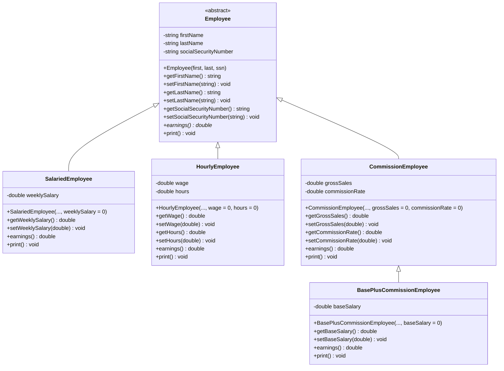

# Bài 2: Hệ thống tính lương cho một công ty

Chương trình C++ minh họa **kế thừa** và **đa hình** (polymorphism) qua hệ thống tính lương hàng tuần cho 4 loại nhân viên.

## Mô tả bài toán

Công ty có 04 loại nhân viên được trả lương hàng tuần:

| Loại nhân viên | Lớp | Cách tính lương |
|---|---|---|
| Lương cố định (không tính giờ làm việc) | `SalariedEmployee` | `weeklySalary` |
| Lương theo giờ | `HourlyEmployee` | Giờ ≤ 40: `wage * hours`. Giờ > 40: `40 * wage + (hours - 40) * wage * 1.5` |
| Hoa hồng | `CommissionEmployee` | `grossSales * commissionRate` |
| Lương cơ bản + hoa hồng | `BasePlusCommissionEmployee` | `baseSalary + grossSales * commissionRate` |

## Sơ đồ lớp



## Chi tiết các lớp

### `Employee` (lớp cơ sở trừu tượng)
- Dữ liệu `private`: `string firstName`, `string lastName`, `string socialSecurityNumber` (số bảo hiểm xã hội).
- Constructor nhận 03 tham số chuỗi: `firstName`, `lastName`, `socialSecurityNumber`.
- Các phương thức `get`/`set` cho từng thành viên dữ liệu `private`.
- Hàm thành viên thuần ảo `virtual double earnings() const = 0;` → `Employee` là lớp cơ sở trừu tượng.
- Phương thức ảo `virtual void print() const;` để thực hiện đa hình.

### `SalariedEmployee`
- Dữ liệu `private`: `double weeklySalary` (lương tuần).
- Constructor với tham số mặc định `weeklySalary = 0`.
- `setWeeklySalary` / `getWeeklySalary`.

### `HourlyEmployee`
- Dữ liệu `private`: `double wage` (lương/giờ), `double hours` (số giờ làm việc trong tuần).
- Constructor với 02 tham số mặc định `wage = 0`, `hours = 0`.
- `set`/`get` cho `wage` và `hours`.

### `CommissionEmployee`
- Dữ liệu `private`: `double grossSales` (tổng doanh số bán), `double commissionRate` (tỉ lệ hoa hồng).
- Constructor với 02 tham số mặc định `grossSales = 0`, `commissionRate = 0`.
- `set`/`get` cho `grossSales` và `commissionRate`.

### `BasePlusCommissionEmployee`
- Kế thừa từ `CommissionEmployee`.
- Dữ liệu `private`: `double baseSalary` (lương cơ bản/tuần).
- Constructor với tham số mặc định `baseSalary = 0`.
- `setBaseSalary` / `getBaseSalary`.

## Cấu trúc thư mục

```
.
├── Employee.h / Employee.cpp
├── SalariedEmployee.h / SalariedEmployee.cpp
├── HourlyEmployee.h / HourlyEmployee.cpp
├── CommissionEmployee.h / CommissionEmployee.cpp
├── BasePlusCommissionEmployee.h / BasePlusCommissionEmployee.cpp
├── main.cpp
└── README.md
```

## Kiến thức áp dụng

- Kế thừa (`public`), lớp cơ sở trừu tượng, hàm thuần ảo.
- Đa hình qua con trỏ/tham chiếu lớp cơ sở, `virtual`, ghi đè (override) `print()` và `earnings()`.
- Đóng gói: thành viên dữ liệu `private`, truy cập qua `get`/`set`.
- Tham số mặc định trong constructor.
